# Mikhyal data model

This is the starting point for the real backend. Every entity is a **zod schema** in `lib/domain/*`, and its TypeScript type is inferred from that schema. The same schemas:
- validate API bodies;
- generate the OpenAPI contract (`GET /api/v1/openapi.json`);
- type the frontend service layer (`lib/api/services.ts`).

The simulated backend (`lib/server/*`) stores these records in memory. It seeds them from the app's current content modules.

## Design principles

1. **Content is declarative data, and simulations are code engines referenced by id.**
   - A mission, lab or phenomenon record is plain JSON.
   - Behaviour that needs code is looked up by `engineId` in the frontend engine registry (`lib/engines/*`). Examples are the braking physics, the circuit MNA solver and the double-slit sampler.
   - Teacher or AI-created labs need no code: their `OutcomeSpec` is `{ kind: "rules" }`, a set of whitelisted math expressions evaluated by `lib/engines/outcomeRules.ts`.
2. **Grading is deterministic and server-side**, with the client keeping the same functions as an offline fallback. The engines are:
   - `lib/engine/evaluator.ts`: symbolic equivalence and units;
   - `lib/workbench/validate.ts`: step reasoning;
   - BKT in `lib/engine/learnerModel.ts`.

   The LLM is used only for tutor replies and, later, generation.
3. **Ids are prefixed strings** (`msn_`, `lab_`, `phn_`, `wbp_`, `exm_`, `cpt_`, `eqn_`, `qty_`, `mis_`, `sim_`, `vcp_`, `usr_`, `cls_`, `ses_`, `evt_`, `tpl_`, `drf_`, `ver_`, `job_`). Content also has a stable **slug** used in URLs.
4. **Content is versioned.** Every content record carries `status` (draft/published/archived), `version`, `authorId` and timestamps. Publishing writes an immutable `ContentVersion` snapshot.

## Entity–relationship diagram

```mermaid
erDiagram
  SUBJECT ||--o{ UNIT : has
  UNIT ||--o{ CONCEPT : groups
  CONCEPT }o--o{ CONCEPT : "prerequisite / related"
  CURRICULUM_OUTCOME }o--o{ CONCEPT : covers
  UNIT ||--o{ CURRICULUM_OUTCOME : lists

  QUANTITY }o--o{ EQUATION : "appears in"
  EQUATION }o--o{ CONCEPT : expresses
  EQUATION }o--o{ EQUATION : "derived from"
  MISCONCEPTION }o--o{ CONCEPT : about

  SIMULATION_ENGINE }o--o{ VISUAL_COMPONENT : renders
  SIMULATION_ENGINE }o--o{ CONCEPT : demonstrates
  VISUALIZATION }o--|| VISUAL_COMPONENT : configures
  VISUALIZATION }o--o| SIMULATION_ENGINE : "binds observables of"

  MISSION }o--o{ CONCEPT : teaches
  MISSION }o--o{ EQUATION : discovers
  MISSION }o--|| SIMULATION_ENGINE : "experiment runs"
  MISSION ||--|| EXAM : "exam mode"
  MISSION ||--o{ MISCONCEPTION : "detects (choice/relation/value/symbol)"
  MISSION }o--o| LAB : "reflection links"
  MISSION }o--o| MISSION : "next mission"
  EXAM ||--o{ QUESTION : contains
  LAB ||--o{ LAB_LEVEL : has
  LAB_LEVEL ||--o{ GOAL : checks
  LAB }o--|| SIMULATION_ENGINE : "sandbox engine"
  PHENOMENON }o--|| SIMULATION_ENGINE : "how-it-works sim"
  PHENOMENON }o--o{ EQUATION : uses
  PHENOMENON }o--o| WORKBENCH_PROBLEM : "full lesson"
  WORKBENCH_PROBLEM ||--|| SOLUTION_GRAPH : "authored routes"
  SOLUTION_GRAPH ||--o{ GRAPH_NODE : has
  SOLUTION_GRAPH ||--o{ GRAPH_EDGE : has
  WORKBENCH_PROBLEM }o--o{ EQUATION : "principles"

  USER ||--o{ CLASSROOM : "teaches (teacher)"
  CLASSROOM ||--o{ ENROLLMENT : has
  USER ||--o{ ENROLLMENT : "student in"
  USER ||--o{ PARENT_LINK : "parent of"
  CLASSROOM ||--o{ ASSIGNMENT : assigns
  ASSIGNMENT }o--|| CONTENT_ITEM : targets

  USER ||--o{ SESSION : starts
  SESSION }o--|| CONTENT_ITEM : on
  SESSION ||--o{ LEARNING_EVENT : logs
  USER ||--|| LEARNER_MODEL : has
  LEARNER_MODEL ||--o{ CONCEPT_MASTERY : tracks
  CONCEPT_MASTERY }o--|| CONCEPT : for

  TEMPLATE ||--o{ STUDIO_DRAFT : instantiates
  USER ||--o{ STUDIO_DRAFT : owns
  STUDIO_DRAFT }o--o| CONTENT_ITEM : publishes
  CONTENT_ITEM ||--o{ CONTENT_VERSION : versions
  AI_GENERATION_JOB ||--o| STUDIO_DRAFT : produces
  USER ||--o{ AI_GENERATION_JOB : requests
  USER ||--o{ AGENT_RUN : starts
  AGENT_RUN ||--o{ AGENT_STEP : records
  AGENT_STEP }o--o| AI_TOOL : calls
  AI_TOOL }o--o{ TOOL_LIBRARY : uses
  AGENT_RUN ||--o| GENERATED_LESSON : publishes
  GENERATED_LESSON ||--|| UI_SPEC : renders
  UI_SPEC }o--o{ TOOL_LIBRARY : requires
  TOPIC }o--o{ CONCEPT : covers
  AGENT_RUN }o--o| TOPIC : draws_on
  ELEMENT_RECORD }o--o{ UI_SPEC : feeds
  DATASET }o--o{ UI_SPEC : feeds
```

`CONTENT_ITEM` is the shared `ContentBase` of Mission, Lab, Phenomenon, WorkbenchProblem and Exam.

## Entities by module

| Module | Entities |
|---|---|
| `curriculum.ts` | SubjectRecord, Unit, Concept (knowledge-graph node with `prerequisites`, `related`, BKT params), CurriculumOutcome (syllabus code, exam weight), KnowledgeGraph (read model) |
| `equations.ts` | Quantity (symbol, SI unit, dimension, domain, sign), Equation (LaTeX + restricted-mathjs relation, quantities, concepts, assumptions, `derivedFrom`) |
| `pedagogy.ts` | Intervention, Misconception (with detector kinds `choice`, `wrong_relation`, `wrong_value`, `forbidden_symbol`), HintLadder (conceptual → strategic → procedural → verification), SolverPrompts, ScaffoldPolicy, NextAction |
| `simulation.ts` | ParamSpec, ObservableSpec, VisualComponent (library of renderers), SimulationEngine (engineId, params, observables, components), Visualization (configured component + bindings), OutcomeSpec (`engine` or `rules`) |
| `content.ts` | ContentBase / ContentSummary; Mission (6-step learning loop); Exam / Question; Lab / LabLevel / Goal; Phenomenon; WorkbenchProblem (with `spec` holding symbols, knowns, model, principles, misconceptions, **SolutionGraph**, checklist, authored paths, recoverable errors) |
| `people.ts` | User (student/teacher/parent/admin), Classroom, Enrollment, ParentLink, Assignment |
| `runtime.ts` | Session, LearningEvent (with optional `evidence` for the learner model), ConceptMastery, LearnerModel, Recommendation, TutorTurn |
| `reports.ts` | ClassReport (step-validity heatmap, misconceptions, reasoning routes, per-student paths), ParentReport, StudentDashboard |
| `authoring.ts` | Template (slots + skeleton), StudioDraft (source: template / scratch / fork / ai, live validation issues), ContentVersion, AIGenerationRequest / AIGenerationJob |
| `ai.ts` | ToolLibrary, AiTool, UiBlock / UiSpec (generative UI `genui/1`), AgentStep, RunRequest, AgentRun, GeneratedLesson, ElementRecord, Dataset, Topic (knowledge-base outline, timeline, FAQ) |
| `requests.ts` | Request bodies for every POST/PUT/PATCH endpoint |

## Workflows the model supports

- **Adaptive learning loop:**
  1. `Session` → `LearningEvent`s (prediction, sim run, equation and answer attempts, hints, tutor, sandbox edits).
  2. The server updates `LearnerModel` (BKT per concept + error-type histogram).
  3. `GET /me/recommendations` picks the next activity: missions whose prerequisite concepts are mastered, then labs, phenomena or workbench items for weak concepts.
- **Diagnosis instead of right/wrong:** misconceptions carry an error type and an intervention. Grading endpoints return a `Diagnosis` and a `NextAction`. Workbench step validation returns three verdicts (mathematical / physical / pedagogical) and an action.
- **Teacher authoring:**
  - **template** (`tpl_discovery_lesson`, `tpl_rules_lab`, `tpl_exam`, `tpl_workbench`, `tpl_visualization`) → `StudioDraft` → `validate` → `publish` → `ContentVersion`, and the item appears in `catalog`;
  - **from scratch** (`contentType` + `content`);
  - **fork** of existing content;
  - **AI** (`/ai/generations` → job → draft).

  Solution graphs are validated with the same checks as the Workbench: cycles, unreachable goals, unproduced requirements and unreadable formulas.
- **AI agents:**
  1. `POST /ai/runs` runs the advisor or the generator.
  2. Each tool call reads the store (topics, concepts, equations, elements, datasets, learner model) or builds and validates UI blocks.
  3. The generator publishes a `GeneratedLesson` whose `UiSpec` the client renders generically.
  4. Runs replay as SSE.
- **Dashboards:**
  - student: `/me/dashboard`, `/me/progress`, `/me/recommendations`;
  - teacher: `/classes/{id}/report` and `/classes/{id}/students/{studentId}/reasoning`;
  - parent: `/me/children` and `/children/{id}/report`.

## Mapping to a relational database (suggested)

| Table | Notes |
|---|---|
| `users`, `classrooms`, `enrollments`, `parent_links`, `assignments` | Plain relational tables; FKs as in the ERD. |
| `subjects`, `units`, `concepts`, `concept_edges(from,to,type)`, `outcomes`, `outcome_concepts` | Knowledge graph as an edge table. |
| `quantities`, `equations`, `equation_quantities`, `equation_concepts` | |
| `content_items(id, slug, type, status, version, author_id, subject, title, …)` | Catalog columns for filtering and search. |
| `content_bodies(content_id, version, body jsonb)` | Type-specific body (mission steps, lab levels, workbench spec) validated by the zod schema on write. |
| `content_concepts`, `content_outcomes`, `content_equations` | Join tables extracted from the body for querying. |
| `misconceptions`, `simulation_engines`, `visual_components`, `visualizations`, `templates` | |
| `studio_drafts(body jsonb, issues jsonb)`, `content_versions(snapshot jsonb)`, `ai_jobs` | |
| `sessions`, `learning_events` (append-only, partition by month), `concept_mastery(user_id, concept_key, mastery, attempts)` | `learner_model` is a view or aggregate over `concept_mastery` and error counts. |

Swap `lib/server/db/store.ts` (in-memory `MemoryCollection`s behind a `Repository` interface) for Postgres repositories. Services and route handlers stay unchanged.
